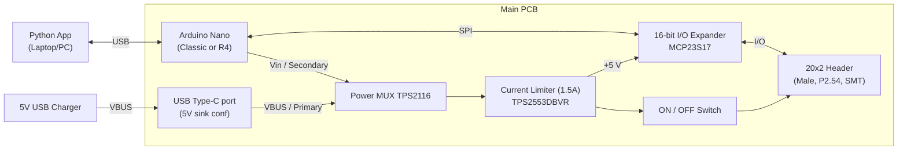
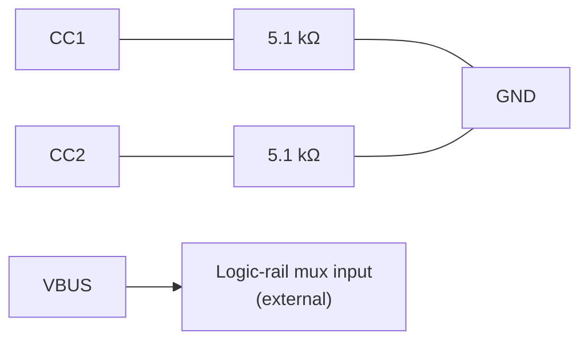
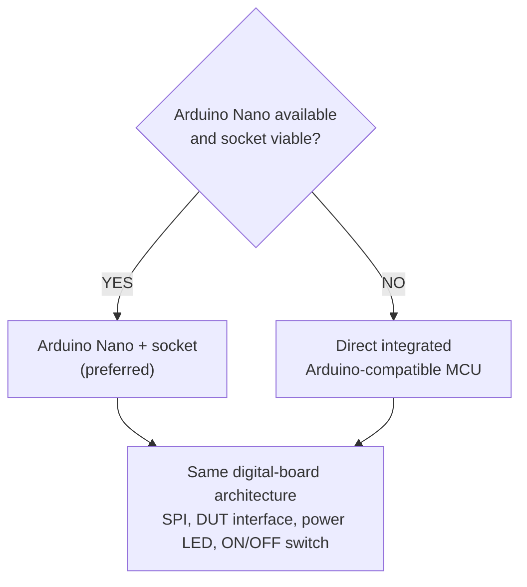

# Minimal Digital Logic Board — Product Specification


| Field         | Value                                        |
| ------------- | -------------------------------------------- |
| Document type | Engineering product specification            |
| Status        | Draft — pre-schematic freeze                 |
| Audience      | PCB designer, manufacturing partner, student |
| Revision      | 2.7                                          |


---

## Table of contents

1. [Purpose and scope](#1-purpose-and-scope)
  - [1.5 PC Python App](#15-pc-python-app)
2. [Concept](#2-concept)
3. [Design philosophy](#3-design-philosophy)
4. [Requirements](#4-requirements)
5. [System overview](#5-system-overview)
6. [Subsystem specifications](#6-subsystem-specifications)
7. [Key problems and proposed solutions](#7-key-problems-and-proposed-solutions)
8. [Component selection](#8-component-selection)
9. [Manufacturing and supply-chain strategy](#9-manufacturing-and-supply-chain-strategy)
10. [Student workflow](#10-student-workflow)
11. [Open engineering items](#11-open-engineering-items)
12. [Decision log](#12-decision-log)

---

## 1. Purpose and scope

### 1.1 Purpose

This document specifies a **minimal digital-logic learning board** for students studying digital logic **at home**. It defines the product concept, design intent, requirements at all relevant levels, system architecture, key engineering problems, and proposed component selections.

The board is a **test tool** for self-study: it generates digital **stimulus**, drives the student's external logic circuit, **captures** circuit outputs, and returns results to the **PC Python App** for verification. It shall remain simple enough for a student to order, receive, connect, and use at home without soldering or specialist equipment.

### 1.2 In scope

- Power architecture (main-board USB-C external input; Arduino Nano **VIN** as laptop power path; **2:1 mux** then **TPS2553-1** on logic **+5 V** rail)
- Digital architecture (MCU, SPI, DUT interface); power LED and **+5 V** rail ON/OFF switch for the student logic circuit
- MCU platform and attachment strategy
- Manufacturing and student-facing usability constraints
- Component selection rationale for the current design direction

### 1.3 Out of scope

- Detailed schematic netlist and PCB layout
- **PC Python App** — full specification in a separate document (see [§1.5](#15-pc-python-app))
- Student circuit (glue logic) — external device under test; not part of the board
- Enclosure or mechanical packaging

### 1.4 Primary success criterion

> **A student shall be able to order the PCB, receive it fully assembled, plug in power and USB, and use it immediately without soldering.**

This criterion takes precedence over any particular Arduino Nano choice.

### 1.5 PC Python App

Specified in a **separate software document**. Hardware-relevant summary:


| Aspect         | Direction                                                                                            |
| -------------- | ---------------------------------------------------------------------------------------------------- |
| Purpose        | GUI to **generate logic stimulus signals** and **read back logic output** from the student's circuit |
| Implementation | **Python** with **Qt** GUI                                                                           |
| Distribution   | Standalone executable — **Windows first**; Mac/Linux later                                           |


| Software          | Role                                                                  | When                                                       |
| ----------------- | --------------------------------------------------------------------- | ---------------------------------------------------------- |
| **Arduino IDE**   | Upload controller firmware to the **Arduino Nano** (one fixed sketch) | Once before first use, and again only for firmware updates |
| **PC Python App** | Generate logic inputs and read back circuit outputs                   | Every study session                                        |


```text
  ONE-TIME (firmware update)                 EVERY STUDY SESSION
  Arduino IDE                                PC Python App
       └── Arduino Nano's USB port                 └── Arduino Nano's USB port
           (Arduino Nano off board)                    (Arduino Nano on board)
```

---

## 2. Concept

### 2.1 Product idea

This board is built for **self-study in digital logic at home**, not as a general Arduino kit.

The board is a **test tool**. The student uses it to **generate digital stimulus**, **feed those signals into their logic circuit** (device under test), and **capture the circuit output** so the PC Python App can show whether the circuit behaves correctly.

### 2.2 Design intent


| Goal                        | How the board supports it                                                          |
| --------------------------- | ---------------------------------------------------------------------------------- |
| Test logic circuits at home | Generate stimulus, capture outputs, verify correctness in PC Python App            |
| Minimise setup friction     | Fully assembled PCB; plug-in Arduino Nano; firmware uploaded once before first use |
| Study without Arduino IDE   | Day-to-day use is the PC Python App only                                           |
| Remain reproducible later   | Small BOM, common parts, JLCPCB-friendly assembly, optional direct-MCU fallback    |


### 2.3 Power and USB topology

The **main board** has one **USB-C** port (5 V sink; 5.1 kΩ CC pulldowns on CC1 and CC2) for an external charger or power bank. The **Arduino Nano's USB port** (USB-C or Micro-USB, depending on Arduino Nano version) connects to the laptop for firmware upload and the PC Python App. The main board has no laptop data port.

On the **Arduino Nano**, the **VIN** pin is internally connected to **USB VBUS**. When the laptop is connected, **~5 V is already present on the seated Arduino Nano VIN pin** — this is the **laptop power path**.

The board **+5 V logic rail** (digital interface and DUT I/O) is **not** taken directly from either connector alone. It is the output of a **2:1 power mux** between:

1. **Arduino Nano VIN** — laptop-supplied 5 V (when the laptop is connected)
2. **Main-board USB-C VBUS** — external charger (direct mux input)

The mux output feeds **TPS2553-1** current limiting, then the logic **+5 V** rail. A **power LED** on this rail indicates that the protected **+5 V** supply is present. An **ON/OFF switch** in series with the DUT I/O power connection lets the student enable or disable **+5 V** to their external logic circuit while the board digital interface remains powered.

When **both** sources are present, the mux **SHALL** select **external VBUS** for the logic rail so the laptop supplies the Arduino Nano (data + Arduino Nano current) but not the heavier logic/DUT load. **TPS2553-1** on the mux output limits current on the logic rail regardless of which source is selected.

The mux output **SHALL NOT** be routed back into Arduino **VIN** — the Arduino Nano is powered from its own USB port, not from the logic rail.


| Cable   | Plug into               | Purpose                                  |
| ------- | ----------------------- | ---------------------------------------- |
| Charger | Main board USB-C        | External 5 V input to the logic-rail mux |
| Laptop  | Arduino Nano's USB port | PC Python App                            |


No on-board battery, boost converter, or USB-PD negotiation.

---

## 3. Design philosophy

The following principles govern all design decisions. Where a trade-off arises, higher-numbered items yield to lower-numbered ones unless explicitly overridden in this specification.


| #   | Principle                                                                                                                                                                                   |
| --- | ------------------------------------------------------------------------------------------------------------------------------------------------------------------------------------------- |
| P1  | **Student usability first** — optimise for plug-and-play home use, not minimum BOM count alone                                                                                              |
| P2  | **No student soldering** — if the assembler can place a part, the student shall not be required to solder it                                                                                |
| P3  | **Minimal hardware** — one main-board USB port (power only); 2:1 mux for the logic +5 V rail only; no USB-PD, no battery management                                                         |
| P4  | **Preserve laptop battery** — when external charger and laptop are both connected, the logic +5 V rail **SHALL** come from external VBUS via the mux, not from Arduino **VIN** / laptop USB |
| P5  | **Robust against mistakes** — **TPS2553-1** current limiting on the **mux output** (logic **+5 V** rail)                                                                                    |
| P6  | **Reproducible later** — prefer common, in-stock parts; avoid obscure connectors and single-source dependencies where practical                                                             |
| P7  | **Replaceable Arduino Nano** — socket-mounted Arduino Nano preferred if assembly cost allows                                                                                                |
| P8  | **Design for manufacture** — JLCPCB (or equivalent) assembly constraints considered from the start                                                                                          |


---

## 4. Requirements

Requirements use RFC 2119 keyword intent:

- **SHALL** — mandatory
- **SHOULD** — strongly desired; deviation requires documented justification
- **MAY** — optional / implementation choice

### 4.1 User requirements (UR)


| ID    | Requirement                                                                                                                                                                                                                  |
| ----- | ---------------------------------------------------------------------------------------------------------------------------------------------------------------------------------------------------------------------------- |
| UR-01 | The student **SHALL** receive a fully assembled main PCB requiring no soldering to use.                                                                                                                                      |
| UR-02 | Controller firmware **SHALL** be uploaded via the Arduino IDE through the **Arduino Nano's USB port**, with the Arduino Nano **removed from the board** (one-time setup or firmware update — **not** repeated each session). |
| UR-03 | The student **SHALL** be able to power the board using a common USB-C phone/laptop charger or power bank.                                                                                                                    |
| UR-04 | During normal use, the student **SHALL** connect a laptop to the **Arduino Nano's USB port** to run the PC Python App; an external charger on main-board USB-C **SHOULD** also be connected.                                 |
| UR-05 | When external board power and a laptop are both connected, the logic **+5 V** rail **SHALL** be supplied from external VBUS via the mux — not from Arduino **VIN** / laptop USB.                                             |
| UR-06 | When no external board power is connected, the logic **+5 V** rail **SHALL** be supplied from Arduino **VIN** (laptop USB via the Arduino Nano's internal VIN–VBUS connection — subject to USB current limits).              |
| UR-07 | The student **SHALL** apply digital stimulus to the DUT and read captured outputs via the PC Python App to verify circuit behaviour.                                                                                         |
| UR-08 | A **power LED** **SHALL** indicate when the protected logic **+5 V** rail is energized.                                                                                                                                      |
| UR-09 | An **ON/OFF switch** **SHALL** let the student enable or disable **+5 V** supply to their external logic circuit (DUT).                                                                                                      |
| UR-10 | The board **SHOULD** remain understandable and reproducible in later years.                                                                                                                                                  |


### 4.2 System requirements (SR)


| ID    | Requirement                                                                                                                                                                                                                                                                                                                                               |
| ----- | --------------------------------------------------------------------------------------------------------------------------------------------------------------------------------------------------------------------------------------------------------------------------------------------------------------------------------------------------------- |
| SR-01 | Logic **+5 V** rail: **2:1 mux** (Arduino **VIN** or main-board **VBUS**) → **TPS2553-1** → board digital interface, **power LED**, and **ON/OFF switch** → DUT I/O power. External **VBUS** preferred when present; laptop-only via **VIN** permitted. Logic rail **SHALL NOT** connect to Arduino **VIN**; Arduino Nano powered from its USB port only. |
| SR-02 | Main-board **USB-C**: **5 V sink** (5.1 kΩ CC pulldowns on CC1 and CC2); **external power only** — no laptop data.                                                                                                                                                                                                                                        |
| SR-03 | **Arduino Nano's USB port** is the sole laptop data path. **SPI** on D10–D13 (CS/SS, MOSI, MISO, SCK). Arduino Nano installable without student soldering.                                                                                                                                                                                                |
| SR-04 | **SHALL NOT** require USB-PD or an on-board 5 V regulator on the USB-derived rail.                                                                                                                                                                                                                                                                        |
| SR-05 | **TPS2553-1** on the mux output limits logic-rail current (target **500–750 mA**, subject to measurement).                                                                                                                                                                                                                                                |


### 4.3 DUT interface and power indication


| ID    | Requirement                                                                                                                                                                                                             |
| ----- | ----------------------------------------------------------------------------------------------------------------------------------------------------------------------------------------------------------------------- |
| IF-01 | Student circuit (glue logic) is external — the DUT, not part of the board.                                                                                                                                              |
| IF-02 | Board digital interface **SHALL** operate at **5 V** compatible with the DUT.                                                                                                                                           |
| IF-03 | A single **power LED** (with current-limit resistor) **SHALL** indicate when the protected logic **+5 V** rail is energized (see UR-08).                                                                                |
| IF-04 | An **ON/OFF switch** **SHALL** control **+5 V** supply to the student logic circuit at the DUT I/O power connection (see UR-09); the board digital interface **SHALL** remain powered independently of switch position. |


### 4.4 Manufacturing


| ID     | Requirement                                                                                  |
| ------ | -------------------------------------------------------------------------------------------- |
| MFG-01 | BOM **SHOULD** favour JLCPCB Basic/Preferred parts where equivalents exist.                  |
| MFG-02 | Footprints and keep-outs **SHALL** be verified against assembler capabilities before freeze. |


### 4.5 Non-functional requirements (NFR)


| ID     | Requirement                                                                     |
| ------ | ------------------------------------------------------------------------------- |
| NFR-01 | Prefer one integrated IC over multiple discrete stages when cost is acceptable. |
| NFR-02 | Stimulus → DUT → capture → verification flow shall be easy to follow.           |
| NFR-03 | Arduino Nano shall be replaceable if a socket is used.                          |
| NFR-04 | Direct-MCU fallback shall preserve the same digital architecture.               |


---

## 5. System overview

### 5.1 Block diagram




### 5.2 Power and host-connection behaviour


| Configuration  | Logic **+5 V** source | Arduino power | Laptop USB current               |
| -------------- | --------------------- | ------------- | -------------------------------- |
| Both connected | External VBUS (mux)   | Laptop USB    | Arduino Nano + data              |
| Laptop only    | Arduino **VIN** (mux) | Laptop USB    | Arduino Nano + logic rail + data |


---

## 6. Subsystem specifications

### 6.1 Power path

The muxed logic **+5 V** rail is shown in [§5.1](#51-block-diagram).

**Explicitly excluded from the main board:**

- Second USB port for laptop data
- USB-PD controller (e.g. STUSB4500L)
- 5 V LDO (e.g. TPS7A2050) when input is already 5 V
- Boost converter
- Battery charger / battery rail

**Main-board USB-C sink:**



### 6.2 Power budget (preliminary)


| Load category               | Notes                                                                                     |
| --------------------------- | ----------------------------------------------------------------------------------------- |
| Board digital interface     | Static and switching current on the board only; student circuit (DUT) load is external    |
| Power LED                   | Single indicator; ~2–5 mA typical                                                         |
| DUT I/O (via ON/OFF switch) | Student logic-circuit supply when switch is ON; included in protected-rail budget         |
| Arduino Nano                | Variant-dependent; include in system max calculation                                      |
| **Target protected limit**  | **500–750 mA** starting point via **TPS2553-1** on mux output; finalise after measurement |


### 6.3 MCU platform


| Candidate                 | Role                   | Notes                                                             |
| ------------------------- | ---------------------- | ----------------------------------------------------------------- |
| **Arduino Nano R4**       | Preferred              | Renesas RA4M1, 5 V, **USB-C**, castellated                        |
| **Arduino Nano Every**    | Alternative            | **Micro-USB**, familiar SPI map                                   |
| **Arduino Nano Classic**  | Fallback only          | **Micro-USB**; ATmega328P availability concern                    |
| **Direct integrated MCU** | Manufacturing fallback | On-board USB for MCU; same logical split (board power vs MCU USB) |


**SPI pinout (all Arduino Nano candidates above):**


| Signal      | Arduino pin |
| ----------- | ----------- |
| CS / SS     | D10         |
| MOSI / COPI | D11         |
| MISO / CIPO | D12         |
| SCK         | D13         |


### 6.4 Arduino Nano attachment

**Preferred:** SMT female socket assembled by PCB manufacturer; student plugs in Arduino Nano.

```text
             Arduino Nano
          +---------------+
          |  USB port       |──────► laptop
          |  (Arduino Nano) |        Arduino IDE / PC Python App
          +---------------+
             ||       ||
        SMT female socket (2×15, 2.54 mm)
===============================
             Main PCB
          USB-C (power in only)
```

**Requirements for socket:** 2 × 15, 2.54 mm pitch, vertical female, SMT, JLCPCB-assemblable, reasonable cost and stock.

**Fallback:** Integrate Arduino-compatible MCU and USB interface directly on main PCB — still no student soldering.

---

## 7. Key problems and proposed solutions

### 7.1 Problem summary


| #   | Problem                                                                                                     | Impact if unsolved                                  |
| --- | ----------------------------------------------------------------------------------------------------------- | --------------------------------------------------- |
| K1  | Main-board power and Arduino Nano's USB port serve different roles — must not be merged on one connector    | Confusion, wrong cabling docs, laptop battery drain |
| K2  | Laptop needed for PC Python App; logic rail load should not drain laptop when external charger is available | Laptop battery drain during use                     |
| K3  | USB 5 V has limited headroom on the main board                                                              | Marginal interface operation if rail sags           |
| K4  | Home-use hardware needs short-circuit protection on the logic **+5 V** rail                                 | Damaged USB source, downtime, safety concern        |
| K5  | USB-PD adds cost/complexity with no benefit for self-study                                                  | Higher BOM, assembly risk, support burden           |
| K6  | Students must not solder                                                                                    | Poor UX; contradicts primary success criterion      |
| K7  | Arduino Nano supply may change over years                                                                   | Board becomes unreproducible                        |
| K8  | Kit must not become the focus instead of the student circuit                                                | Student tests glue logic, not board firmware        |
| K9  | Firmware must be loaded before Arduino Nano is seated                                                       | Cannot upload through board socket alone            |


### 7.2 Proposed solutions


| Problem        | Proposed solution                                                                                                                | Rationale                                                            |
| -------------- | -------------------------------------------------------------------------------------------------------------------------------- | -------------------------------------------------------------------- |
| **K1, K2**     | **Separate connectors:** main-board USB-C = external power; Arduino Nano's USB port = laptop; **2:1 mux** on logic **+5 V** only | Clear roles; external preferred for logic load                       |
| **K2 (power)** | Mux selects **external VBUS** for logic rail when both sources present; Arduino powered from its **USB port** only               | Preserves laptop battery for logic/DUT current                       |
| **K3**         | Direct USB 5 V to mux inputs (no LDO)                                                                                            | Minimises voltage drop                                               |
| **K4**         | **TI TPS2553-1** on **mux output** (logic **+5 V** rail)                                                                         | Current-limited switch; protects rail regardless of mux source       |
| **K5**         | 5.1 kΩ CC pulldowns on main-board USB-C only                                                                                     | 5 V default USB-C supply; no PD                                      |
| **K6**         | JLCPCB-assembled SMT Arduino Nano socket                                                                                         | Student plugs Arduino Nano and cables only                           |
| **K7**         | Arduino Nano now; direct integrated MCU fallback later                                                                           | Same SPI/digital architecture                                        |
| **K8**         | Keep Arduino Nano as transparent transport; focus stays on the student-built DUT                                                 | Stimulus/capture/verify model                                        |
| **K9**         | Document workflow: flash Arduino Nano **off board**, then insert                                                                 | Uses the **Arduino Nano's USB port** natively; no ISP through socket |


### 7.3 Rejected alternatives


| Alternative                        | Reason for rejection                                                          |
| ---------------------------------- | ----------------------------------------------------------------------------- |
| STUSB4500L USB-PD sink             | Unnecessary for 5 V-only requirement; adds cost and complexity                |
| Schottky diode OR-ing (logic rail) | Integrated 2:1 mux preferred for clean source selection and back-feed control |
| Laptop USB port on main PCB        | Wrong partition — host USB belongs on Arduino Nano                            |
| TPS7A2050 5 V LDO (primary)        | Redundant when input is regulated USB 5 V                                     |
| Student-soldered Arduino Nano      | Violates UR-01 and P2                                                         |


---

## 8. Component selection

### 8.1 Selected / leading candidates


| Function                 | Part                           | Status                     | Key parameters                                                          |
| ------------------------ | ------------------------------ | -------------------------- | ----------------------------------------------------------------------- |
| Logic-rail current limit | **TI TPS2553-1**               | Leading candidate          | On **mux output**; adjustable limit on logic **+5 V** rail              |
| Logic-rail 2:1 mux       | **TI TPS2116** (or equivalent) | Leading candidate          | Arduino **VIN** vs external **VBUS** → **TPS2553-1** → logic rail       |
| Main-board USB-C         | TBD (6-pin or 16-pin)          | Open                       | **Power only** — VBUS + CC1/CC2; 5 V sink                               |
| CC pulldown              | 5.1 kΩ × 2                     | Confirmed approach         | One pair on main-board USB-C                                            |
| Arduino Nano (preferred) | **Arduino Nano R4**            | Preferred                  | USB-C                                                                   |
| Arduino Nano (alt.)      | Arduino Nano Every / Classic   | Alternative                | Micro-USB                                                               |
| Arduino Nano socket      | 2 × 15, 2.54 mm SMT female     | Open — verify JLCPCB stock | Must be assembler-placed                                                |
| Power LED                | TBD                            | Open                       | Single indicator on protected logic **+5 V** rail; with series resistor |
| DUT ON/OFF switch        | TBD (SPST)                     | Open                       | Controls **+5 V** to student logic circuit at DUT I/O power             |
| DUT interface            | TBD                            | Open                       | Connectors / level-compatible I/O to external student circuit           |
| USB ESD protection       | TBD                            | Open — evaluate            | On main-board USB-C power port if required                              |


### 8.2 Power subsystem — design notes

See **SR-01**, **SR-02**, and **SR-05**. Open items: current-limit resistor value, mux part selection, back-feed verification.

**Arduino Nano when seated:** powered from **USB port** only; **VIN** → mux input only.

### 8.3 Parts explicitly not required


| Part class             | Example considered | Decision     |
| ---------------------- | ------------------ | ------------ |
| USB-PD controller      | STUSB4500L         | Not required |
| 5 V LDO (primary rail) | TPS7A2050          | Not required |
| Battery management     | —                  | Not required |


---

## 9. Manufacturing and supply-chain strategy

### 9.1 Manufacturing principle

> **If the PCB assembler can place/reflow a component, the student shall not be required to solder that component.**

### 9.2 Target production flow

```text
Student orders PCB + assembly
        |
        v
Manufacturer assembles board (and socket if used)
        |
        v
Student receives assembled board
        |
        v
Student plugs in Arduino Nano (if using socket)
        |
        v
Upload controller firmware via the **Arduino Nano's USB port** (Arduino Nano **off board**) — once
        |
        v
Insert Arduino Nano into board socket
        |
        v
Student connects external charger to main-board USB-C
        |
        v
Student connects laptop to **Arduino Nano's USB port** → PC Python App
```

### 9.3 Supply-chain strategy



Long-term reproducibility **SHALL NOT** depend on a single Arduino Nano SKU without a documented fallback.

---

## 10. Student workflow

### 10.1 One-time setup (before first use)

Performed **once** when the Arduino Nano is first commissioned — or again **only** when a firmware update is released.

```text
Take the Arduino Nano (not plugged into the board)
        |
        v
Connect laptop to Arduino Nano's USB port (USB-C or Micro-USB — depends on Arduino Nano version)
        |
        v
Open Arduino IDE → select Arduino Nano → upload controller firmware
        |
        v
Disconnect laptop from the Arduino Nano
        |
        v
Plug the Arduino Nano into the board socket
        |
        v
Done — Arduino IDE not needed again unless firmware is updated
```

### 10.2 Normal use (every session)

Use the **PC Python App only** — no Arduino IDE.

```text
The Arduino Nano is already on the board with firmware loaded
        |
        v
Connect external USB-C charger to main-board USB-C (board power)
        |
        v
Set DUT **ON/OFF switch** to ON (powers student logic circuit)
        |
        v
Confirm **power LED** is lit (+5 V rail energized)
        |
        v
Connect laptop to Arduino Nano's USB port (host communication)
        |
        v
Launch PC Python App (Windows .exe)
        |
        v
Generate stimulus and read back captured outputs via GUI
        |
        v
Check captured outputs against expected behaviour
```

---

## 11. Open engineering items

The following items **SHALL** be closed before schematic/PCB freeze.

### 11.1 Power

- [ ] Measure or estimate maximum logic-rail current (interface + DUT I/O when switch is ON)
- [ ] Calculate and set TPS2553-1 current-limit resistor (**mux output** / logic rail)
- [ ] Select logic-rail **2:1 mux** IC (e.g. TPS2116) and confirm external-VBUS priority behaviour
- [ ] Verify **no back-feed** from external VBUS into laptop via Arduino **VIN** / USB
- [ ] Confirm mux output is **not** routed to Arduino **VIN**
- [ ] Select main-board USB-C connector and footprint (power-only)
- [ ] Characterise laptop-only mode: max logic-rail load when powered only from Arduino **VIN**
- [ ] Select DUT **ON/OFF switch** (rating, footprint, silkscreen labelling)
- [ ] Select power LED and series resistor (brightness vs. current)
- [ ] Decide on USB-C ESD protection on main-board power port

### 11.2 MCU / Arduino Nano

- [ ] Verify JLCPCB stock for 2 × 15, 2.54 mm SMT female socket
- [ ] Confirm socket assembly reliability and cost
- [ ] Compare Arduino Nano R4 vs Arduino Nano Every availability and price
- [ ] Verify full pin compatibility beyond SPI if support for multiple Arduino Nano variants is claimed
- [ ] Define integrated-MCU fallback architecture if socket is unavailable

### 11.3 Digital interface

- [ ] Define DUT connector and interface pinout
- [ ] Worst-case dynamic current at intended switching frequency (board only)
- [ ] Confirm 5 V logic compatibility across all digital parts

### 11.4 Manufacturing

- [ ] Complete JLCPCB DFM review
- [ ] Minimise non-Basic/Extended parts where possible
- [ ] Validate BOM for student reproducibility

---

## 12. Decision log


| ID   | Decision                                                                                                                  | Status                                                                    |
| ---- | ------------------------------------------------------------------------------------------------------------------------- | ------------------------------------------------------------------------- |
| D-01 | Main-board power: single USB-C 5 V sink (external charger / power bank)                                                   | **Approved**                                                              |
| D-04 | Logic-rail current limit: **TPS2553-1** on **mux output**                                                                 | **Approved — leading candidate**                                          |
| D-05 | No USB-PD on main-board power port; CC pulldowns only                                                                     | **Approved**                                                              |
| D-06 | No 5 V LDO on primary USB-derived rail                                                                                    | **Approved**                                                              |
| D-07 | MCU: Arduino Nano family; R4 preferred (USB-C on the Arduino Nano's USB port)                                             | **Approved — pending socket verification**                                |
| D-08 | Arduino Nano attachment: SMT socket (preferred) or integrated MCU (fallback)                                              | **Approved — pending JLCPCB check**                                       |
| D-09 | MCU–board interface: SPI on D10–D13                                                                                       | **Approved**                                                              |
| D-10 | **Power LED** on protected logic **+5 V** rail                                                                            | **Approved — part TBD**                                                   |
| D-19 | **ON/OFF switch** on DUT I/O **+5 V** supply for student logic circuit                                                    | **Approved — part TBD**                                                   |
| D-11 | No student soldering                                                                                                      | **Approved**                                                              |
| D-12 | Schottky diode OR-ing rejected for logic rail; use integrated 2:1 mux                                                     | **Approved**                                                              |
| D-18 | Logic **+5 V** rail: **2:1 mux** (Arduino **VIN**                                                                         | external **VBUS**) → **TPS2553-1** → logic rail; not connected to **VIN** |
| D-13 | STUSB4500L USB-PD rejected                                                                                                | **Approved**                                                              |
| D-14 | PC Python App: Python + Qt; Windows-first standalone exe; separate software spec                                          | **Approved**                                                              |
| D-15 | Arduino IDE = one-time firmware upload only; PC Python App = all normal use                                               | **Approved**                                                              |
| D-16 | Host USB on **Arduino Nano's USB port** (USB-C or Micro-USB per Arduino Nano variant); main-board USB-C is **power only** | **Approved**                                                              |
| D-17 | Firmware uploaded to Arduino Nano **before** it is plugged into the board                                                 | **Approved**                                                              |


---

*End of specification*